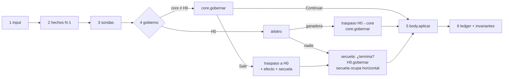

# Parkour V3.2 — Arquitectura: gobierno único con secuela acotada

> **Estado:** propuesta de arquitectura completa para revisión. No implementada.
> Reemplaza como marco general a `v3_autoridad_movimiento_propuesta.md` en los
> puntos que se indican explícitamente; todo lo demás de V3 se hereda.
>
> **Etiquetas usadas en este documento:**
> `[V3]` decisión heredada sin cambios · `[V3.2]` decisión nueva propuesta acá ·
> `[ABIERTA]` requiere decisión del usuario antes de implementar.

---

## 0. Resumen en diez líneas

1. Un solo **gobernante** por tick, como en V3. H0 es el gobernante por defecto.
2. Un core no termina cuando termina su acción: al salir puede dejar **una
   secuela**, que es la única cosa que sobrevive a un cambio de gobierno.
3. La secuela es un objeto propio del core saliente (su código, su config, su
   reloj). **No escribe nada de H0 y H0 no la conoce.**
4. La secuela sólo puede reemplazar **un canal cerrado** del comando de H0
   (hoy: sólo `horizontal`). Nunca gravedad, postura, permisos ni pose.
5. Como mucho existe **una** secuela, sólo mientras gobierna H0, y muere ante
   cualquier cambio de gobierno, su propia condición física o su tope temporal
   obligatorio. Por construcción no puede haber dos secuelas en conflicto.
6. Los **efectos instantáneos** (launch, snap) son una clase aparte: una
   aplicación, máximo uno por tick.
7. Las **condiciones externas** (penalización por caída) no modifican a nadie:
   se publican y cada core decide si las consume.
8. El input se consume por **tokens de pulsación**: una pulsación la usa un solo
   core; nadie la reinterpreta después como intención sostenida.
9. El orden del tick es **explícito**, dirigido por un único driver; deja de
   depender de `process_physics_priority`.
10. Cada modelo del documento `v3_2_modelos.md` se usa sólo donde su pregunta es
    la correcta: estados para *quién gobierna*, restricción para *el sostén*,
    modificador para *la secuela*, prioridad sólo *en la entrada* (árbitro).

---

## 1. Por qué existe V3.2

### 1.1 El límite estructural de V3

V3 decidió: *un core gobierna, termina por completo y devuelve el gobierno a
H0* (`H0 → core → H0`). Esa regla funciona para acciones que no dejan nada vivo
al terminar. Hanging sí deja algo vivo: el salto de salida necesita un control
aéreo propio (0.75 s) distinto del de H0 (0.35 s), y ese control dura **más**
que el core que lo originó.

Con cores exclusivos, una consecuencia que sobrevive a su creador no tiene
dueño legítimo. V3 exploró las tres salidas posibles y las tres fallan:

| Intento | Documento | Por qué no alcanza |
| --- | --- | --- |
| Hanging escribe la duración en H0 (`reset_air_control(0.75)`) | `v3_1_control_aereo_autoridad_pendiente.md` | Inyección: un core modifica config de otro. Rechazada por el usuario. |
| H0 tiene una tabla de perfiles de reentrada (`NORMAL`, `REENTRADA_TRAVERSAL`) | `v3_h0_perfiles_control_aereo_reentrada.md` | H0 tiene que anticipar cada tipo de consecuencia ajena. Crece con cada mecánica nueva; H0 termina conociendo el parkour entero. |
| Una sola ventana de 0.75 s para todo H0 | Estado actual del código | Compromiso: pierde la intención de diseño (H0 = 0.35) para esquivar el problema. |

### 1.2 Evidencia empírica del estado actual

Sonda headless corrida el 2026-09-25 contra `v3_hanging_detection_lab.tscn`
(captura, salida con Espacio mirando hacia afuera, sin input de movimiento):

```text
tick  comando   horizontal  vy
+3    launch    4.924       -0.868   ← body aplica el launch
+4    motion    0.000       -1.032   ← H0 retoma y anula el horizontal
+5    motion    0.000       -1.195
```

- **El launch horizontal muere un tick después.** El control aéreo de H0 es
  "total": sin input, la velocidad objetivo es cero
  (`h0_core.gd:_get_air_control_velocity`). El salto dirigido por cámara sólo
  conserva su dirección si el jugador mantiene una tecla.
- **Espacio sostenido desde la salida produjo 3 saltos de H0 al aterrizar.** La
  misma pulsación que Hanging consumió como "salir" la reinterpretó H0 como
  "intención continua de saltar".

Ninguno de los dos casos se puede corregir bien dentro de V3 sin inyección. El
primero pide que la política aérea posterior a Hanging sea **de Hanging**; el
segundo pide que el input tenga **dueño**.

### 1.3 Lo que se atacó antes de diseñar

Las cuatro opciones de `v3_2_modelos.md` se sometieron a ataques (sesión
2026-09-25). Las fallas que sobrevivieron y que V3.2 tiene que resolver son:

| # | Ruptura | Sección que la resuelve |
| --- | --- | --- |
| R1 | Nueva mecánica empieza mientras vive una consecuencia (reagarre) | §5.4, §7 |
| R2 | Aspectos acoplados (posición/velocidad/gravedad) con dueños distintos; eventos sin dueño | §4, §6 |
| R3 | Estado zombie: la base acumula estado mientras está tapada | §5.5, §8 |
| R4 | Vetos y valores se combinan distinto | §9 |
| R5 | El orden de nodos decide resultados | §3 |
| R6 | Consecuencias cuyo fin físico nunca llega | §5.3 |
| R7 | De dónde lee sus valores un modificador | §5.2 |

---

## 2. Lo que V3.2 hereda sin cambios

`[V3]` Todo esto sigue vigente tal como está escrito en los documentos V3:

- `V3PhysicsBody` es el **único escritor** del `CharacterBody3D`.
- Cada core es dueño de la semántica de su mecánica; la capa física es neutral
  y no sabe qué es un borde.
- Contrato **reactivo por tick**: el gobernante emite una intención cada tick y
  lee el resultado real el tick siguiente.
- Soportes **metaestables**: toda referencia a borde, piso o plataforma se
  relee cada tick.
- Sondas **bobas**; interpretación en el consumidor (evaluator del core).
- Gatillo contextual: prerrequisitos duros → distribución de certeza 100 →
  umbral 90 → entrada. Ctrl mantenido excluye a los cores que lo consumen.
- Muerte → ragdoll fuera del sistema de cores. Bloqueo de voluntad → se corta
  la captura de input, no se le avisa al árbitro.
- Sin autoloads, sin singletons, sin switchboard, sin grupos usados como bus.
- Debug de primera clase: toda decisión deja un motivo legible.

## 3. Qué cambia respecto de V3

| Regla V3 | Regla V3.2 | Motivo |
| --- | --- | --- |
| "No se combinan solicitudes de movimiento de H0 y del core activo." | **Una sola fuente por canal por tick.** H0 gobierna; una secuela puede ocupar el canal `horizontal`. | Es la única forma de que una consecuencia tenga dueño sin inyección (§1.1). |
| El core termina al terminar su acción. | El core puede dejar **una secuela** al salir. | Hanging deja consecuencias vivas. |
| Hanging suspende/reactiva H0 llamándolo directamente. | Los cores no se referencian entre sí. **`V3Gobierno`** ejecuta los traspasos. | Elimina acoplamiento core↔core. |
| Orden por `process_physics_priority`. | Orden explícito por un único driver de tick (§3.1). | R5; elimina los retrasos T+1 accidentales. |
| Input: booleans compartidos (`jump_pressed`, `jump_just_pressed`). | Input con **tokens de pulsación** consumibles (§8). | Evidencia §1.2 (3 saltos fantasma). |
| Paso por H0 entre cores: duración abierta. | **Máximo un traspaso de gobierno por tick.** Salir en N ⇒ H0 gobierna el tick N; la entrada más temprana a otro core es N+1. | Determinismo; cierra una pregunta abierta de V3. |
| `H0.air_control_duration = 0.75` (unificado). | H0 vuelve a **0.35 s**. Los 0.75 s pasan a ser config de Hanging. | La unificación era un parche. |
| Hechos físicos como `Dictionary`. | `V3Hechos` tipado. | Errores de clave silenciosos. |

### 3.1 El tick, explícito

`[V3.2]` Un solo nodo raíz del player (`V3Player`) tiene `_physics_process`.
Los demás exponen métodos que el driver llama en orden fijo. El driver no
interpreta mecánicas: sólo conoce las fases.

```text
tick N
 1. input      V3InputSource.capturar()            → V3InputFrame (tokens)
 2. hechos     V3PhysicsBody.hechos()              → V3Hechos (resultado de N-1)
 3. observar   sondas.observar(hechos)             → lecturas crudas
 4. gobierno   V3Gobierno.resolver(ctx)
                 a. si gobierna un core ≠ H0: core.gobernar(ctx)
                      → Continuar(comando, efecto?) | Salir(salida)
                      → si Salir: traspaso a H0 (consume el cupo de traspaso)
                 b. si gobierna H0 y hay cupo: árbitro evalúa candidatas
                      → si hay ganadora: traspaso H0 → core; core.gobernar(ctx)
                 c. si gobierna H0: secuela.debe_terminar(hechos)?
                      → H0.gobernar(ctx) → comando velocidad
                      → si hay secuela viva: reemplaza comando.horizontal
 5. aplicar    V3PhysicsBody.aplicar(comando, efecto)   ← único move del tick
 6. registrar  V3Gobierno.cerrar_tick()   → ledger + invariantes
```

Consecuencia directa: **una decisión se aplica en el mismo tick en que se
toma.** Desaparecen los "T+1" que hoy existen porque Hanging decide en
prioridad 160 y el body aplica en 100 (ver `v3_hanging_arbol_eventos.md` §7 y
el feedback de perfiles, punto 2).



---

## 4. Piezas y responsabilidades

| Pieza | Hace | No hace |
| --- | --- | --- |
| `V3Player` (driver) | Llama las fases en orden. | Interpretar input, geometría o mecánicas. |
| `V3InputSource` | Publica `V3InputFrame` con tokens; registra consumos. | Saber qué core existe. |
| `V3PhysicsBody` | Aplica un comando continuo y como mucho un efecto; publica `V3Hechos` con el resultado. | Elegir mecánicas, componer canales, conocer secuelas. |
| Sondas | Leen el mundo. | Decidir gameplay. |
| `V3Arbitro` | Compara candidatas sólo cuando gobierna H0. | Interpretar geometría, mover, ejecutar cores. |
| `V3Gobierno` | Posee: gobernante actual, secuela actual, cupo de traspaso del tick, ledger. Ejecuta traspasos y compone el canal `horizontal`. Verifica invariantes. | Saber qué es Hanging. Decidir entradas (eso es el árbitro). Leer config de cores. |
| `H0Core` | Locomoción normal; emite `ComandoVelocidad`. | Conocer secuelas, cores o motivos de salida. |
| Cores (`V3HangingCore`, …) | Candidatean, gobiernan, salen con una `V3Salida`. | Referenciar a otro core. Escribir el body. |
| `V3Secuela` | Produce el valor de su canal mientras vive; declara su fin. | Leer o escribir estado de H0. Referenciar su core de origen. |
| Condiciones externas | Publican estados (p. ej. `salto_penalizado`). | Modificar comandos. |

### 4.1 Dos formatos de comando, cerrados

`[V3.2]` Cierra la pregunta abierta de `v3_formato_solicitud_fisica_problema.md`
y adopta el híbrido de `v3_modelos_movimiento_discusion.md` sin su tercer caso:

| Comando | Quién lo usa | Qué aplica el body |
| --- | --- | --- |
| `ComandoVelocidad { horizontal, pide_salto, postura }` | H0 (y futuros cores de locomoción libre) | `velocity.xz = horizontal`, salto si hay piso, gravedad, `move_and_slide()`. |
| `ComandoPose { pose_objetivo, tolerancia }` | Hanging (sostén, shimmy, subida por tramos) | Intenta llevar el cuerpo a la pose con barrido de colisión; sin gravedad. Publica `alcanzada / bloqueada`. |

No existe un "comando de trayectoria". Una mecánica con recorrido planificado
(subida, mantle) emite un `ComandoPose` por tick siguiendo su plan interno;
eso ya era regla de V3 (el core no entrega trayectorias autónomas).

Agregar un tercer formato es una decisión de arquitectura, no de
implementación.

### 4.2 Efectos instantáneos

`[V3.2]` Resuelve la mitad "eventos sin dueño" de R2.

| Efecto | Qué hace | Origen permitido |
| --- | --- | --- |
| `EfectoLaunch { velocidad }` | Reemplaza la velocidad completa una vez. | Gobernante, o la `V3Salida` de un core. |
| `EfectoSnap { pose }` | Coloca el cuerpo en una pose validada. | Gobernante (entrada a Hanging). |

Reglas:

- Máximo **un efecto por tick**. Un segundo efecto es un error de contrato
  (assert en debug), no algo que se resuelva por prioridad. No existe caso de
  gameplay legítimo con dos (§7, ataque A9).
- El tick con efecto lo **ocupa el efecto**: el body aplica el efecto,
  ejecuta un `move_and_slide()` con esa velocidad y descarta el canal
  `horizontal` del comando continuo de ese tick. Es lo que ya hace
  `V3PhysicsBody` con el launch; V3.2 lo convierte en regla escrita.
- Un efecto no es un canal: nadie lo "posee" más allá del tick en que se
  aplica.

---

## 5. La secuela

Es la pieza central de V3.2.

### 5.1 Definición

Una **secuela** es la consecuencia de una acción que termina, con dueño,
alcance y fin propios. La crea el core saliente dentro de su `V3Salida`. Vive
mientras gobierna H0 y ocupa uno o más canales de un catálogo cerrado del
`ComandoVelocidad`.

```text
V3Salida
  motivo:   enum (HANGING_SALTO, HANGING_SOLTAR, HANGING_BLOQUEO, …)
  efecto:   EfectoLaunch | null
  secuela:  V3Secuela | null
```

La `V3Salida` no contiene nada dirigido a H0. H0 nunca la ve.

### 5.2 Qué es y qué no es inyección

| | Inyección (rechazada) | Secuela |
| --- | --- | --- |
| ¿Cambia config o estado de H0? | Sí | No. H0 conserva 0.35 s y su reloj intacto. |
| ¿Quién ejecuta el cálculo? | H0, con un valor ajeno | La secuela, con su propia config. |
| ¿De quién es el valor 0.75? | Pasa a vivir en H0 | Sigue siendo un `Resource` de Hanging. |
| ¿Qué queda cuando termina? | H0 alterado hasta que alguien lo restaure | Nada. H0 nunca fue tocado. |
| ¿H0 necesita saber algo? | Sí (motivo, perfil o duración) | No. |

La implementación del control aéreo se comparte; la config no. `[V3.2]`
`V3DireccionAerea` es una función pura:

```gdscript
# Sin estado. Misma implementación para H0 y para cualquier secuela.
static func calcular(perfil: V3PerfilDireccionAerea, velocidad_actual: Vector3,
        direccion_input: Vector3, sprint: bool, delta: float) -> Vector3
```

`V3PerfilDireccionAerea` (Resource, **inmutable en runtime**):

| Campo | H0 (`h0_aire.tres`) | Hanging salto (`hanging_salto_aire.tres`) |
| --- | --- | --- |
| `duracion_s` | 0.35 | 0.75 |
| `velocidad_objetivo` / `velocidad_sprint` | 5.0 / 8.0 | a calibrar |
| `aceleracion` | instantánea (control total, como hoy) | finita, a calibrar |
| `sin_input_conserva_inercia` | false (como hoy) | **true** (arregla §1.2) |

Esto responde a R7: la secuela no lee valores de H0 ni del core que la creó.
Carga su propio perfil y no guarda ninguna referencia al nodo de origen, así
que sigue siendo válida aunque ese nodo se libere.

`[ABIERTA]` La semántica exacta del perfil de salida de Hanging (aceleración,
si conserva inercia sin input) se decide en playtest; la arquitectura sólo
garantiza que esos valores pertenezcan a Hanging.

### 5.3 Ciclo de vida

```text
nace     en el traspaso core → H0, dentro de V3Salida
vive     cada tick que gobierna H0: primero debe_terminar(hechos), luego producir()
muere    por la primera de estas causas:
           a. su condición física        (p. ej. hechos.en_piso)
           b. su tope temporal           (obligatorio, R6)
           c. cualquier cambio de gobierno (H0 → cualquier core)
           d. interrupción obligatoria externa
```

`[V3.2]` Reglas:

1. **Tope temporal obligatorio.** Toda secuela declara `tope_s > 0`. Sin él no
   se acepta en la `V3Salida` (assert). Así no existe una secuela inmortal
   aunque su condición física nunca llegue (caída al vacío, agua, respawn).
2. **Muere al cambiar el gobierno.** No se suspende ni se reanuda. Si te
   agarrás y te soltás enseguida, la secuela anterior ya no existe. `[ABIERTA]`
   Confirmar que esa es la sensación deseada; es la opción determinista.
3. **Sin referencias al origen.** Una secuela no guarda punteros a su core. Lo
   que necesite lo copia al nacer (su perfil y, si hace falta, el vector de
   launch).
4. **Nadie la mata "a mano".** Sólo mueren por (a)–(d); ningún core ni H0 tiene
   una API para borrarla.

### 5.4 Por qué nunca hay dos secuelas (R1)

- Una secuela sólo nace en un traspaso **core → H0**.
- Todo traspaso **H0 → core** la destruye.
- Todo core sale siempre a H0 (regla V3 que se conserva).

Entonces entre el nacimiento de una secuela y la siguiente oportunidad de crear
otra hay siempre un traspaso H0 → core, que mata a la primera. **Como mucho hay
una secuela, y siempre sobre H0.** No hace falta un resolvedor ni prioridades,
porque el conflicto es imposible por construcción.

El reagarre (R1) queda así:

```text
N    Hanging sale por salto → efecto launch + secuela(horizontal, 0.75)
N+1  H0 gobierna; la secuela ocupa horizontal
N+18 contacto nuevo → árbitro → traspaso H0 → Hanging → la secuela muere
N+40 Hanging sale por salto → secuela nueva, desde cero
```

### 5.5 Canales: catálogo cerrado (R2)

`[V3.2]` El único canal que una secuela puede ocupar es:

| Canal | Campo | Por qué es seguro |
| --- | --- | --- |
| `horizontal` | `ComandoVelocidad.horizontal` | El body lo aplica directo a `velocity.xz`, y H0 lo recalcula cada tick desde los hechos y el input. Reemplazarlo no desacopla nada. |

Lo que queda **fuera** y por qué:

- **Vertical / gravedad:** acoplados a la integración del body y al daño por
  caída. Si alguien los necesita, usa un `EfectoLaunch`, no un canal.
- **Postura:** es intención persistente del jugador (toggle). Una secuela que
  la ocupara dejaría estado ambiguo al morir.
- **Permiso de salto / vetos:** los vetos se combinan con Y lógico, no se
  reemplazan (R4). Van por condiciones externas (§9).
- **Pose / orientación:** son exclusivas de un gobernante con `ComandoPose`.

Agregar un canal al catálogo es una decisión de arquitectura. Criterio: el
campo tiene que ser recalculado por H0 cada tick sin memoria de su valor
anterior (ver regla de salida pura, §6.2).

---

## 6. H0 en V3.2

### 6.1 Lo que no cambia

H0 conserva todas sus reglas de `v3_h0_fundamento.md`: locomoción en suelo y
aire, salto sin coyote ni buffer, crouch toggle, crouch aéreo que achica la
cápsula, sprint y penalización por caída consumida como condición externa.

### 6.2 Lo que se agrega

`[V3.2]` **Retomar desde hechos.** Cuando H0 vuelve a gobernar
(`al_retomar(hechos)`), rearma su estado derivado sólo desde hechos físicos:

```text
_was_on_floor := hechos.en_piso        (no un valor viejo de antes de ceder)
si no hechos.en_piso: inicia SU ventana aérea (0.35 s): "empezar a gobernar en el aire"
postura deseada: se conserva (es intención del jugador, no de la mecánica)
```

No recibe motivo, perfil, ticket ni duración. Esto reemplaza a
`reset_air_control()`, `set_locomotion_suspended()` y a la idea de
`accept_exit(ticket)` de V3.1.

`[V3.2]` **Regla de salida pura** (R3): si un canal de H0 puede ser ocupado por
una secuela, H0 lo calcula sin usar su propio valor anterior como memoria. Hoy
`horizontal` ya cumple (lo calcula desde la velocidad real del body, el input y
su reloj). Si mañana H0 necesitara memoria en ese cálculo, el canal deja de ser
elegible para secuelas.

`[V3.2]` **Mientras no gobierna, H0 no corre.** Se conserva la suspensión de
V3. H0 no acumula estado mientras está tapado (R3), así que no hay estado
zombie. El único momento en que H0 corre con un canal ocupado es con una
secuela viva, y ahí aplica la regla de salida pura.

### 6.3 Interacción de relojes (determinista)

Con una secuela de 0.75 s y la ventana de H0 de 0.35 s, las dos iniciadas en el
traspaso:

```text
0.00 – 0.75  la secuela ocupa horizontal (el reloj de H0 corre igual)
0.35         vence la ventana de H0 (no se nota: el canal está ocupado)
0.75         la secuela muere → H0 sin ventana → conserva inercia hasta tocar piso
```

Si una secuela durara menos que la ventana de H0, al morir H0 retoma el resto
de **su** ventana con **su** semántica. Las dos rutas son explicables desde el
ledger (§10).

---

## 7. Hanging en V3.2

`[V3]` Se conserva la entrada decidida: sondas → evaluator → candidata → cilindro/esfera →
contacto → prerrequisitos → árbitro. También las cuatro salidas de
`v3_hanging_ciclo_propuesta.md` y el soporte metaestable (P recalculada cada
tick).

`[V3.2]` Lo que cambia es cómo gobierna y cómo sale:

| Fase | Comando / efecto | Notas |
| --- | --- | --- |
| Entrada | `EfectoSnap(P)` en el mismo tick del traspaso | El body valida la ocupación; si la rechaza, Hanging sale con `HANGING_BLOQUEO`, sin secuela. |
| Sostén | `ComandoPose(P_actual)` por tick | P se recalcula desde la lectura actual del borde. El sostén es una restricción física expresada como pose (modelo 4, sólo dentro de Hanging). |
| Shimmy | `ComandoPose(P_lateral)` | Igual que hoy, pero como pose barrida, no como snap. |
| Subida | `ComandoPose` por tramo del plan interno | `[ABIERTA]` Propuesta: la subida es una fase de Hanging (como en `v3_hanging_plan_funcional_minimo.md`), no un traspaso a Mantle. Mantle queda como core propio para entradas desde H0. |

Salidas:

| Salida | `V3Salida` |
| --- | --- |
| Espacio | `{ HANGING_SALTO, EfectoLaunch(cámara), Secuela(horizontal, hanging_salto_aire.tres, fin: en_piso, tope 0.75) }` |
| Ctrl / atrás | `{ HANGING_SOLTAR, null, null }`. Queda el bloqueo de recaptura, que es estado propio de Hanging (§9). |
| Pérdida de soporte | `{ HANGING_SIN_SOPORTE, null, null }` |
| Pose bloqueada | `{ HANGING_BLOQUEO, null, null }` |

---

## 8. Input con tokens de pulsación

`[V3.2]` Resuelve la mitad "input" de R3 y la evidencia de §1.2.

`V3InputFrame` publica, por acción:

```text
sostenida: bool
pulsacion_id: int        # cambia con cada flanco de bajada; 0 si no está sostenida
flanco: bool             # true sólo en el tick del flanco
consumida_por: StringName  # vacío o el nombre del core que la usó
```

Reglas:

1. **Una pulsación, un consumidor.** El core que actúa sobre un flanco lo
   consume (`frame.consumir(&"jump", self)`). Un segundo consumo de la misma
   `pulsacion_id` es un error de contrato.
2. **La intención sostenida sólo vale si la pulsación no fue consumida por
   otro.** El "Espacio sostenido repite el salto" de H0 sigue existiendo, pero
   sólo para pulsaciones que nacieron bajo H0 o que nadie consumió.
3. El consumo dura lo que dura la pulsación: al soltar la tecla, el registro se
   borra.

Casos:

| Situación | V3 hoy | V3.2 |
| --- | --- | --- |
| Espacio para salir de Hanging, sostenido hasta aterrizar | 3 saltos H0 | 0 saltos. Hay que soltar y volver a apretar. `[ABIERTA]` confirmar. |
| Ctrl para soltar Hanging | H0 no hace toggle porque estaba suspendido ese tick (dependía del orden) | H0 no hace toggle porque la pulsación está consumida (regla explícita). |
| Ctrl mantenido para bloquear la entrada | Booleano leído por Hanging | Igual: `sostenida` bloquea; el bloqueo no consume. |

---

## 9. Qué persiste y dónde

Esta tabla es la que responde "¿dónde vive esto?" para cualquier consecuencia
futura. R4 queda resuelto porque cada clase tiene una sola regla de
combinación.

| Clase | Quién la crea | Vida | Qué toca | Cómo se combina | Ejemplo |
| --- | --- | --- | --- | --- | --- |
| **Comando** | Gobernante | 1 tick | Cuerpo, de forma continua | Único por tick | Velocidad de H0, pose de Hanging |
| **Efecto instantáneo** | Gobernante o `V3Salida` | 1 aplicación | Velocidad o transform, una vez | Máx. 1 por tick | Launch, snap |
| **Secuela** | Core saliente | Hasta fin/tope/cambio de gobierno | Un canal del comando de H0 | Máx. 1, reemplaza el canal | Control aéreo tras salto de Hanging |
| **Condición externa** | Sistema externo | Hasta que su dueño la retire | Nada; se lee | Cada core decide si la consume (Y lógico en prerrequisitos) | Salto penalizado por caída |
| **Estado propio** | El core | Mientras exista el core | Sólo sus propias decisiones | No se combina | `recapture_locked` de Hanging |
| **Hecho físico** | Body | Hasta el próximo tick | Nada; se lee | — | Velocidad real, `en_piso` |

Criterio de clasificación para una consecuencia nueva:

```text
¿afecta sólo las decisiones futuras del mismo core?   → estado propio
¿es un cambio físico de una vez?                       → efecto instantáneo
¿es un hecho del mundo o del cuerpo?                   → hecho físico (ya lo publica el body)
¿la origina algo ajeno al parkour y restringe?         → condición externa
¿cambia cómo se mueve el player bajo H0 por un tiempo? → secuela (si cabe en el catálogo)
nada de lo anterior                                     → decisión de arquitectura
```

`[ABIERTA]` ¿La penalización de salto por caída bloquea el salto de *salida*
de Hanging? Es decisión de Hanging (¿consume esa condición?), no de la
arquitectura.

---

## 10. Gobierno, árbitro e invariantes

### 10.1 `V3Gobierno`

Estado:

```text
gobernante: V3Core             (H0 por defecto)
secuela: V3Secuela | null
traspaso_usado_este_tick: bool
ledger: buffer circular de los últimos N ticks
```

Operaciones (las únicas que cambian gobierno):

```text
conceder(core, candidata)   H0 → core      mata la secuela; H0 deja de correr
devolver(salida)            core → H0      instala efecto y secuela; H0.al_retomar(hechos)
interrumpir(motivo)         core → H0      obligatoria; sin secuela; core.al_ser_interrumpido()
```

No elige entradas (eso lo hace el árbitro) ni lee config de cores.

### 10.2 Árbitro

`[V3]` Se conserva el diseño de certeza contextual. `[V3.2]` precisa cuándo
corre:

- Corre **sólo si gobierna H0** y el cupo de traspaso del tick está libre.
- No existen transiciones directas entre cores (regla V3): Hanging no puede
  ceder a Ladder sin pasar por H0, y H0 dura al menos el tick de la salida.
- Los cores no contextuales (parry, doble salto) piden gobierno por su propia
  directiva. `[ABIERTA]` Si en el mismo tick coinciden un gatillo contextual y
  un pedido explícito, propuesta: gana el pedido explícito del jugador sobre la
  inferencia contextual.

### 10.3 Invariantes

`[V3.2]` Se verifican en `cerrar_tick()` con `assert` en builds de debug y se
cubren en smoke tests. Si alguno falla, es un bug de contrato, no un caso de
diseño.

| # | Invariante |
| --- | --- |
| I1 | Hay exactamente un gobernante por tick. |
| I2 | Existe como mucho una secuela, y sólo si el gobernante es H0. |
| I3 | Hay como mucho un traspaso de gobierno por tick. |
| I4 | Hay como mucho un efecto instantáneo por tick. |
| I5 | Sólo `V3PhysicsBody` escribe transform y velocidad del cuerpo. |
| I6 | Ningún core guarda una referencia a otro core. |
| I7 | Ningún `Resource` de config se modifica en runtime. |
| I8 | Toda secuela tiene `tope_s > 0` y ninguna referencia a su core de origen. |
| I9 | Una `pulsacion_id` tiene como mucho un consumidor. |
| I10 | El árbitro no corre mientras gobierna un core distinto de H0. |
| I11 | Ningún nodo que participe del tick de movimiento (input, sondas, cores, gobierno, body) implementa su propio `_physics_process`; sólo el driver. La presentación (cámara, overlays) queda fuera de esta regla. |

### 10.4 Ledger de debug

Cada tick registra una línea:

```text
#1843 gob=H0 sec=Hanging.salto_aire[horizontal] 0.42s | efecto=— | tokens: jump#77→Hanging | árbitro: hanging 0 (sin_contacto)
#1844 gob=H0 sec=✝ fin=en_piso | efecto=— | …
```

El overlay muestra el tick actual y el ledger permite volver hacia atrás. Con
esto, cualquier resultado raro se explica leyendo la tabla, no reproduciendo
a mano.

---

## 11. Batería de destrucción aplicada a V3.2

Cada ataque indica la regla que lo resuelve. Los que siguen abiertos lo dicen
explícitamente.

| # | Ataque | Qué pasa en V3.2 | Regla |
| --- | --- | --- | --- |
| A1 | Salto de Hanging sin input | La secuela conserva el launch; al morir queda la inercia | §5.2 perfil |
| A2 | Reagarre a 0.3 s | Traspaso H0 → Hanging mata la secuela | §5.4 |
| A3 | Espacio sostenido desde la salida | Pulsación consumida por Hanging: 0 saltos fantasma | §8 |
| A4 | Ctrl para soltar y H0 retoma el mismo tick | Pulsación consumida: H0 no hace toggle | §8 |
| A5 | Salir y reentrar en el mismo tick | Cupo de un traspaso por tick; más el bloqueo de recaptura de Hanging | I3 |
| A6 | Agacharse en el aire durante la secuela | Postura no es canal de secuela: H0 la maneja normal | §5.5 |
| A7 | Aterrizar durante la secuela | `debe_terminar(en_piso)` antes de producir | §5.3a |
| A8 | Caída al vacío con secuela viva | Tope temporal | §5.3b, I8 |
| A9 | Launch + salto H0 en el mismo tick | Imposible: la pulsación de Espacio ya la consumió Hanging; efecto único | I4, I9 |
| A10 | Snap de entrada rechazado | Salida `HANGING_BLOQUEO`, sin secuela, H0 retoma | §7 |
| A11 | Core de origen liberado con secuela viva | La secuela no lo referencia | I8 |
| A12 | Ladder aparece en pleno salto de Hanging | Gobierna H0 → el árbitro puede conceder Ladder → la secuela muere | §5.4 |
| A13 | Mover nodos cambia el resultado | El orden lo fija el driver, no las prioridades | §3.1, I11 |
| A14 | Relojes H0 y secuela | Resultado definido para ambos órdenes | §6.3 |
| A15 | Dos contactos de captura simultáneos | **Sigue abierto** (heredado de V3): no se resuelve por orden de lista | — |
| A16 | Barrido entre ticks de rayos horizontales a alta velocidad | **Sigue abierto** (heredado de V3) | — |
| A17 | Una mecánica futura necesita una secuela sobre un core ≠ H0 | **No soportado a propósito.** Si aparece, se reabre la arquitectura. | §5.4 |
| A18 | Presión para agregar canales al catálogo | Criterio de §5.5 + decisión explícita | §5.5 |

**Dónde puede volverse caótico V3.2**, dicho con honestidad:

- **Si el catálogo de canales se abre sin criterio.** Con dos canales que
  interactúan (p. ej. horizontal y vertical) vuelve R2.
- **Si se permite que una secuela sobreviva a un cambio de gobierno.**
  Aparecen dos secuelas y hace falta resolvedor (vuelve R1).
- **Si un core empieza a leer las secuelas ajenas para decidir.** Leer el
  motivo de salida publicado en el ledger o en los hechos está permitido. Leer
  el estado interno de una secuela no, porque la convierte en un canal oculto.

Las tres están bloqueadas por invariantes o por reglas escritas. Romperlas
requiere cambiar este documento, no sólo el código.

---

## 12. De dónde sale cada idea

Investigación del 2026-09-25 sobre fuentes oficiales y código abierto. Lo que
no se pudo verificar se dice explícitamente.

### 12.1 Lo que se toma

- **UE5 Mover** ([conceptos](https://dev.epicgames.com/documentation/unreal-engine/mover-features-and-concepts-in-unreal-engine),
  [API](https://dev.epicgames.com/documentation/unreal-engine/API/Plugins/Mover)).
  Separa tres cosas que V3 mezclaba:
  - un *Movement Mode* activo por vez (`UMovementModeStateMachine`);
  - *Layered Moves* (`FLayeredMoveBase`): movimiento temporal con `DurationMs`,
    `MixMode`, `Priority` e `IsFinished` propios;
  - *Instant Movement Effects* (`FInstantMovementEffect`: `FTeleportEffect`,
    `FJumpImpulseEffect`, `FApplyVelocityEffect`): se aplican una vez y
    desaparecen.

  V3.2 toma esa separación: gobernante / secuela / efecto (§4.2, §5). También
  hay un precedente directo de "consecuencia que termina por un hecho físico":
  `FLayeredMove_MultiJump` se termina solo al tocar piso.
- **Pitfall documentado de Mover**
  ([foro de Epic](https://forums.unrealengine.com/t/mover-plugin-roadmap-and-layering-issues/2712958)).
  Un layered move de root motion con `OverrideAll` suprime la gravedad del modo
  y el personaje queda flotando. Es la ruptura R2 ocurriendo en un motor real.
  Por eso V3.2 deja la vertical fuera del catálogo de canales (§5.5).
- **UE CharacterMovementComponent, *Root Motion Sources*.**
  - [`FRootMotionSource`](https://dev.epicgames.com/documentation/en-us/unreal-engine/API/Runtime/Engine/FRootMotionSource):
    `Duration`, `AccumulateMode` Override/Additive y `FinishVelocityParams`
    (`MaintainLastRootMotionVelocity`, `SetVelocity`, `ClampVelocity`). Una
    fuente temporal declara qué velocidad deja al terminar. En V3.2 el
    equivalente es implícito y único: al morir la secuela, la velocidad real
    queda y H0 decide desde los hechos (en la práctica, `MaintainLast`).
  - `LaunchCharacter` guarda un `PendingLaunchVelocity` que se consume en un
    punto definido del tick. Es el mismo patrón que `EfectoLaunch`.
  - CMC no tiene una ventana temporal de control aéreo: `AirControl` es un
    valor fijo de config. Ese hueco es justo el que V3.2 cubre.
- **Celeste, `Player.cs`** ([código](https://github.com/NoelFB/Celeste/blob/master/Source/Player/Player.cs)).
  - Tras un wall jump el jugador sigue en `StNormal`. `WallJump()` carga
    `forceMoveX` / `forceMoveXTimer` (`WallJumpForceTime = 0.16`) y, mientras
    el timer vive, se **reescribe el input horizontal** que lee la locomoción
    base. Nunca cambia la tuning de la base.
  - Es una secuela de un solo canal, sin prioridades, en un juego conocido por
    su control preciso.
  - Los conflictos se resuelven con resets explícitos dentro de cada acción
    (`Jump()` y `WallJump()` limpian los timers competidores).
  - V3.2 hace lo mismo, pero con dueño y contrato: la secuela muere en el
    traspaso (§5.4) en vez de depender de que cada acción se acuerde de
    limpiar.
- **Quake III, ioquake3 `bg_pmove.c`** ([código](https://github.com/ioquake/ioq3)).
  - `PMF_TIME_KNOCKBACK` + `pm_time`: el walk move base **lee un flag
    temporizado** y usa aceleración aérea sin tocar sus valores.
  - `PMF_TIME_WATERJUMP` termina por timeout o por un hecho (la vertical se
    vuelve negativa).
  - Los dos son el mismo contrato que la secuela: una política temporal ajena a
    la base, con fin por hecho físico o por tope.
- **Consumo de pulsaciones, precedentes directos de §8:**
  - Source Engine `CGameMovement::CheckJumpButton`
    ([source-sdk-2013](https://github.com/ValveSoftware/source-sdk-2013)):
    marca `IN_JUMP` en `m_nOldButtons` ("don't pogo stick") y la pulsación
    queda consumida hasta soltarla.
  - Quake `PMF_JUMP_HELD`: exige soltar antes de volver a saltar.
  - Monocle/Celeste `VirtualButton.ConsumePress()`.
  - Godot documenta que el polling de `Input` es estado global que
    `set_input_as_handled()` no afecta
    ([docs](https://docs.godotengine.org/en/stable/tutorials/inputs/inputevent.html)).
    La propiedad del input hay que construirla, y ese es el motivo de los
    tokens.
- **Overgrowth, `aircontrols.as`** ([código](https://github.com/WolfireGames/overgrowth)).
  - Un objeto `JumpInfo` por fase aérea que `StartJump()`, `StartWallJump()` y
    `StartFall()` reinician. Es análogo a "una secuela nueva desde cero".
  - Un reagarre exitoso arma `ledge_delay = 0.3`, un cooldown de re-agarre que
    es estado propio de la mecánica. Es análogo al bloqueo de recaptura de
    Hanging (§9).
- **Kinematic Character Controller (Unity).** Mientras el estado Climbing
  gobierna, los campos del estado Default quedan **congelados**, y el riesgo
  documentado son los pedidos viejos al volver. Por eso V3.2 congela H0 igual
  pero lo obliga a **retomar desde hechos** (§6.2), no desde lo que tenía
  guardado.
- **Game Programming Patterns, capítulo "State"** ([texto](https://gameprogrammingpatterns.com/state.html)).
  - Las máquinas concurrentes justifican separar *quién gobierna* de *qué lo
    modula*, en vez de multiplicar estados (`AireDesdeHanging`,
    `AireDesdeLadder`, …).
  - El propio autor plantea como ideal que una máquina pueda *consumir* un
    input para que la otra no reaccione, aunque no lo implementa. §8 sí.
- **V2 `TraversalLease`:** un dueño explícito del gobierno, que sólo el motor
  invalida. Reaparece como `V3Gobierno`, sin la acumulación de mecánicas del
  `TraversalController`.
- **V1:** tenía dos perfiles aéreos (`AIR_CONTROL_FAST/SLOW`) y salidas con
  impulso propio por tipo. Confirma que el feel buscado necesita políticas
  aéreas distintas según el contexto. V3.2 les da dueño en vez de ramas en un
  mismo controlador.

### 12.2 Dónde V3.2 se aparta a propósito

| Fuente | Qué hace | Qué hace V3.2 | Por qué |
| --- | --- | --- | --- |
| Mover | Varios layered moves a la vez; **sobreviven a cambios de modo**; conflicto por `Priority` + desempate por hora de inicio. | Una secuela; **muere en cualquier cambio de gobierno**; sin prioridades. | Es exactamente lo que genera el resolvedor que se quiere evitar (R1). |
| Mover `FStanceModifier` | Escribe settings del componente y los revierte en `OnEnd`. | Prohibido: configs inmutables (I7). | Es la inyección que motivó V3.2. |
| Celeste | Los timers viven en el player y corren siempre; cada acción limpia a mano los que compiten. | La secuela es un objeto con fin declarado; el traspaso la mata sin que nadie se acuerde. | Evita olvidar un reset. |
| Quake `pm_time` | Un solo slot; si está ocupado, el primero gana. | Nunca hay dos pretendientes (§5.4). | El conflicto no puede ocurrir. |

### 12.3 Lo que no se pudo verificar

- El orden interno de subpasos de `UMovementModeStateMachine::OnSimulationTick`
  (código detrás de login).
- El desempate exacto por hora de inicio en Mover.
- Las charlas de arquitectura de Mirror's Edge, Assassin's Creed Unity,
  Titanfall 2 y Dying Light (pagas o sólo en video).
- No existe guía oficial de Godot sobre *layered moves* para
  `CharacterBody3D`.

V3.2 no depende de ninguno de estos puntos.

---

## 13. Plan de migración desde el código actual

No autoriza implementación. Cada fase cierra con un smoke test headless
verde y deja el laboratorio jugable.

| Fase | Cambio | Cierra cuando |
| --- | --- | --- |
| M0 | `V3Hechos` tipado en lugar de `Dictionary`. | Los smoke tests actuales pasan sin cambios de comportamiento. |
| M1 | Driver `V3Player` con fases explícitas; los nodos dejan `_physics_process`. | Mismo comportamiento; desaparecen los T+1 de snap y launch; I11. |
| M2 | `V3Gobierno` + `V3Salida`; Hanging deja de llamar a H0; H0 obtiene `al_retomar(hechos)`. | I1, I3, I6; test de reagarre. |
| M3 | Tokens de pulsación. | A3 y A4 en verde (0 saltos fantasma). |
| M4 | `ComandoPose` barrido para el sostén y el shimmy; `EfectoSnap` sólo en la entrada. | Sostén sin snap por tick; salida por bloqueo físico testeada. |
| M5 | `V3DireccionAerea` + perfiles `.tres`; H0 vuelve a 0.35 s. | H0 idéntico a hoy salvo la duración; I7. |
| M6 | `V3Secuela` + la salida de Hanging por salto la emite. | A1, A2, A7, A8 en verde. |
| M7 | Invariantes en `cerrar_tick()` + ledger en el overlay. | La batería §11 completa como test. |

---

## 14. Decisiones que necesita el usuario

1. **Aprobar el cambio de regla central:** de "una fuente por tick" a "una
   fuente por canal por tick, con como mucho una secuela sobre H0".
2. **Espacio sostenido tras una salida de Hanging:** ¿0 saltos (propuesto) o
   se mantiene el comportamiento actual?
3. **Perfil aéreo de la salida de Hanging:** ¿conserva el launch sin input
   (propuesto) o usa control total como H0?
4. **Reagarre:** ¿la secuela muere definitivamente al volver a Hanging
   (propuesto) o debería retomarse?
5. **Penalización por caída:** ¿bloquea el salto de salida de Hanging?
6. **Subida desde Hanging:** ¿fase de Hanging (propuesto) o core Mantle?
7. **Empate pedido explícito vs gatillo contextual:** ¿gana el explícito
   (propuesto)?

## 15. Documentos que este reemplaza o actualiza

| Documento | Estado con V3.2 |
| --- | --- |
| `v3_1_control_aereo_autoridad_pendiente.md` | Histórico. La alternativa elegida no es A, B ni C, sino la secuela (§5). |
| `v3_h0_perfiles_control_aereo_reentrada.md` | Reemplazado. H0 no conoce clases de reentrada. |
| `v3_autoridad_movimiento_propuesta.md` | Vigente, salvo la regla "no se combinan solicitudes" (§3). |
| `v3_formato_solicitud_fisica_problema.md` | Cerrado por §4.1 y §4.2. |
| `v3_modelos_movimiento_discusion.md` | Cerrado: dos comandos, sin trayectoria como formato. |
| `v3_2_modelos.md` | Respondido: §0 punto 10. |
| `v3_decisiones_abiertas.md` | Cierra 1.3, 1.5, 1.6, 2.1, 2.2, 3.5 (parcial), 6.1. |
