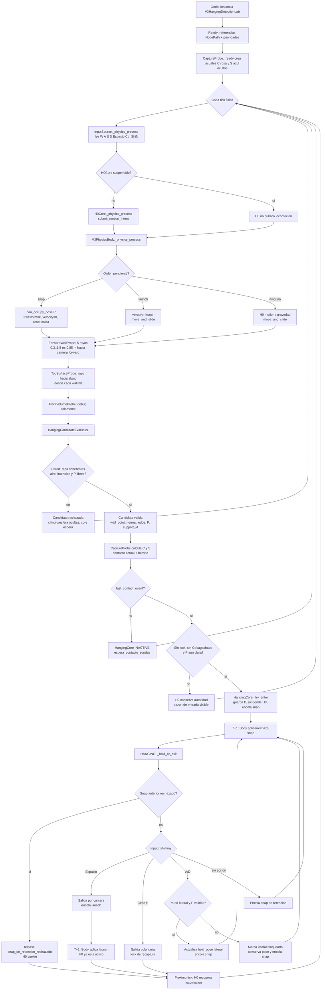

# V3 Hanging — árbol exhaustivo de eventos del laboratorio

## Alcance y cómo leerlo

Este árbol describe el runtime que existe hoy en
`scenes/test/v3_hanging_detection_lab.tscn`: desde que Godot instancia la
escena hasta que el player se cuelga, se desplaza lateralmente o vuelve a H0.
No describe una versión futura con switchboard, Marker3D, mantle, esquinas,
animación o soportes móviles. Cada nodo nombra el **script :: función** que
efectivamente se ejecuta y deja claro si produce un hecho, toma una decisión o
aplica física.

Convenciones:

- `→` es un hecho/dato que pasa al siguiente nodo; no implica que el receptor
  pueda mover el body.
- `T+1` significa el siguiente tick físico. El body está en prioridad 100 y
  Hanging decide en 160, por eso un snap/launch solicitado por Hanging nunca
  se materializa en el mismo tick.
- `P` es la pose de agarre (`candidate.hang_pose`), calculada por el evaluator.
- `C` es el disco de captura sobre el muro; `S` es la esfera de captura dentro
  del player. Son sondas matemáticas/visuales: no son colliders de gameplay.
- Las etiquetas entre comillas son los valores reales de `last_entry_reason`,
  `last_exit_reason`, `last_contact_kind` o `rejection_reasons` que se pueden
  leer en el debug.

## Mapa de actores, rutas y botones

| Rol | Nodo de la escena | Script | Funciones que importan aquí |
| --- | --- | --- | --- |
| Entrada | `H0Lab/PlayerH0Lab/Body/InputSource` | `v3_input_source.gd` | `_physics_process()` |
| Locomoción H0 | `.../Body/H0` | `h0_core.gd` | `_physics_process()`, `set_locomotion_suspended()` |
| Autoridad física | `.../Body` | `v3_physics_body.gd` | `submit_motion_intent()`, `submit_pose_snap()`, `submit_launch()`, `_physics_process()`, `can_occupy_pose()` |
| Cámara | `.../Body/CameraRig` | `v3_camera_rig.gd` | `_unhandled_input()`, `get_planar_forward()`, `get_planar_right()`, `get_view_forward()` |
| Pared | `ForwardWallProbe` | `v3_forward_wall_probe.gd` | `_physics_process()` |
| Tapa | `TopSurfaceProbe` | `v3_top_surface_probe.gd` | `_physics_process()` |
| Volumen frontal de debug | `FrontVolumeProbe` | `v3_front_volume_probe.gd` | `_physics_process()` |
| Intérprete de borde / P | `HangingCandidateEvaluator` | `v3_hanging_candidate_evaluator.gd` | `_physics_process()`, `_find_best_hanging_geometry()`, `_interpret_edge_pair()`, `_apply_hang_pose()`, `_classify_intent()` |
| Sondas cilindro/esfera | `HangingCaptureProbe` | `v3_hanging_capture_probe.gd` | `_physics_process()`, `_make_disk_center()`, `_distance_to_vertical_disk()`, `_swept_sensor_touches_disk()` |
| Core local | `HangingCore` | `v3_hanging_core.gd` | `_physics_process()`, `_try_enter()`, `_hold_or_exit()`, `_jump_exit()`, `_get_jump_exit_velocity()`, `_release()` |
| Debug Hanging | `HangingDebugCanvas/HangingDebug` | `v3_hanging_debug_overlay.gd` | `_process()` |
| Debug H0 | `H0Lab/DebugCanvas/H0Debug` | `v3_h0_debug_overlay.gd` | `_process()` |

| Acción de input | Tecla del mapa actual | En H0 | En Hanging |
| --- | --- | --- | --- |
| `move_forward` | **W** | Avanza respecto de la cámara. | No es una acción de Hanging específica: sostiene la pose. |
| `move_back` | **S** | Retrocede respecto de la cámara. | Si `movement_axis.y > 0.2`, suelta voluntariamente. |
| `move_left` / `move_right` | **A / D** | Desplazamiento H0. | Shimmy sobre el eje local X de P. |
| `jump` | **Espacio** | Salta sólo desde piso si daño de caída no lo bloquea. | Un flanco (`jump_just_pressed`) sale con launch dirigido por cámara. |
| `crouch` | **Ctrl** | Toggle de postura solicitado por H0. | Mantenido bloquea entrada; un flanco mientras ya está colgado suelta. |
| `run` | **Shift** | Velocidad de sprint. | No modifica directamente el ciclo Hanging actual. |

## Orden real de un tick físico

| Prioridad | Script :: función | Resultado disponible ese mismo tick |
| ---: | --- | --- |
| -200 | `V3InputSource :: _physics_process` | Lee W/A/S/D, Espacio, Ctrl y Shift en `movement_axis`, flancos y mantenidos. |
| -50 | `V3FallDamageState :: _physics_process` | Actualiza si el último aterrizaje bloquea el salto de H0. |
| 0 | `H0Core :: _physics_process` | Si no está suspendido, publica una intención de movimiento/crouch/salto para el body. |
| 100 | `V3PhysicsBody :: _physics_process` | Aplica primero snap pendiente, luego launch pendiente o finalmente la intención H0; es el único que mueve. |
| 140 | `V3ForwardWallProbe :: _physics_process` | Publica la grilla de impactos de pared tras el movimiento del body. |
| 141 | `V3TopSurfaceProbe :: _physics_process` | Publica una lectura descendente de tapa por cada impacto de pared. |
| 142 | `V3FrontVolumeProbe :: _physics_process` | Publica volumen frontal para debug; no habilita ni bloquea Hanging. |
| 150 | `V3HangingCandidateEvaluator :: _physics_process` | Publica candidata, razones de rechazo y P. |
| 155 | `V3HangingCaptureProbe :: _physics_process` | Publica cilindro/esfera, contacto actual/barrido y flanco de contacto. |
| 160 | `V3HangingCore :: _physics_process` | Decide entrar, retener, hacer shimmy o salir; encola orden física para T+1. |
| 200 | `V3CameraRig :: _physics_process` | Actualiza la presentación/altura de cámara; la rotación viene de `_unhandled_input`. |

El debug corre en `_process()` después de la física del frame y por ello ve los
hechos que ya publicaron providers, evaluator, sondas y core.

## Árbol de eventos completo



## 1. Inicio de escena y estado base

```text
V3HangingDetectionLab (Node3D)
├─ instancia V3H0Lab
│  └─ PlayerH0Lab / Body (V3PhysicsBody)
│     ├─ InputSource
│     ├─ CameraPivot / View / Camera3D
│     ├─ CameraRig
│     ├─ FallDamageState
│     └─ H0
├─ PracticeLedge (StaticBody3D): muro + tapa física del laboratorio
├─ ForwardWallProbe
├─ TopSurfaceProbe
├─ FrontVolumeProbe
├─ HangingCandidateEvaluator
├─ HangingCaptureProbe
├─ HangingCore
└─ HangingDebugCanvas / HangingDebug
```

1. Godot resuelve los `NodePath` declarados en la escena. No hay singleton,
   grupo ni búsqueda implícita: cada actor recibe sus referencias en el `.tscn`.
2. `V3PhysicsBody :: _ready()` duplica la cápsula de pie, prepara su cápsula
   crouch y queda en prioridad 100. Si no encuentra una cápsula válida emite un
   error y las reglas de postura no pueden funcionar.
3. `V3CameraRig :: _ready()` captura el mouse, recuerda altura de ojos y queda
   en prioridad 200. `CameraRig :: _unhandled_input()` convierte el mouse en
   yaw de `CameraPivot` y pitch de `View`, limitado a ±89°.
4. Los tres providers, el evaluator, `CaptureProbe` y `HangingCore` establecen
   sus prioridades en `_ready()`. `CaptureProbe :: _ready()` crea dos mallas
   de debug, las deja invisibles y no crea `Area3D` ni collider.
5. Antes de una captura, `HangingCore.state == INACTIVE`,
   `recapture_locked == false` y H0 tiene autoridad de locomoción.

## 2. Acercarse al muro con H0 y verlo aparecer en debug

```text
Jugador mantiene W (opcional Shift) y orienta cámara hacia la PracticeLedge
  ↓
InputSource._physics_process
  movement_axis = (0, -1), sprint_active = Shift
  ↓
H0Core._physics_process, si locomotion_suspended == false
  direction = camera.right * X + camera.forward * -Y
  ↓
V3PhysicsBody.submit_motion_intent(H0, velocidad, salto, crouch)
  ↓
V3PhysicsBody._physics_process
  aplica movimiento/gravedad y move_and_slide()
  ↓
ForwardWallProbe._physics_process observa la nueva posición
```

En piso, **Espacio** no inicia Hanging. H0 calcula
`last_jump_requested = jump_pressed && is_on_floor && !jump_is_penalized`; el
body acepta esa orden con `velocity.y = jump_velocity` (5 m/s por default).
Después de abandonar el suelo, H0 conserva control aéreo por hasta 0.35 s y
los providers siguen evaluando el muro en cada tick. No hay requisito de caer:
una captura puede ocurrir mientras el body todavía asciende.

La detección visual se compone así:

```text
ForwardWallProbe :: _physics_process
  para alturas [0.3, 0.6, 0.9, 1.2, 1.5] m sobre Body
  lanza un rayo 0.85 m hacia CameraRig.get_planar_forward()
  publica last_wall_samples[] y last_planar_forward
      ↓
TopSurfaceProbe :: _physics_process
  para cada impacto de pared, parte desde body.Y + 1.8 m
  con offset 0.08 m hacia el interior de la tapa y raya hacia abajo
  publica { wall_hit, top_hit } en last_surface_samples[]
      ↓
FrontVolumeProbe :: _physics_process
  consulta una caja 0.7 × 1.2 × 0.85 m delante del body
  publica last_hits[] exclusivamente para debug
```

`V3HangingDebugOverlay :: _process()` escribe entonces: número de sondas
crudas de pared/tapa/volumen, rayos que impactaron, borde, normal, altura
relativa, intención, alineación, validez de P, candidata y razones de rechazo.
Que el contador de pared salte en debug sólo significa que hay impactos crudos;
todavía no significa que exista un agarre ni que H0 haya cedido autoridad.

## 3. Árbol de candidata: de muro detectado a borde utilizable

`V3HangingCandidateEvaluator :: _physics_process()` crea una candidata nueva
cada tick. Nunca mueve el body ni solicita un snap.

```text
¿Faltan referencias?
├─ sí → reject("referencias_incompletas") → inválida
└─ no
   ├─ ¿Body.is_on_floor()?
   │  ├─ sí → agrega reject("en_piso"), pero continúa relevando geometría
   │  └─ no → continúa sin ese rechazo
   └─ _find_best_hanging_geometry()
      ├─ para cada pareja wall_hit/top_hit llama _interpret_edge_pair()
      │  ├─ wall_hit o top_hit vacíos → descarta muestra
      │  ├─ pared demasiado inclinada → descarta muestra
      │  ├─ forward no apunta hacia la pared → descarta muestra
      │  ├─ pared/tapa separadas lateralmente > 0.35 m → descarta muestra
      │  ├─ tapa con inclinación > 30° → descarta muestra
      │  ├─ borde fuera de altura [0.5, 1.5] m → descarta muestra
      │  └─ pareja válida → guarda la de mayor alineación de pared
      ├─ ninguna pareja → reject("sin_pared_y_borde_coherentes") → inválida
      └─ mejor pareja
         ├─ _apply_geometry(): wall_point, normal, edge, altura, alignment,
         │   support_id = instance_id del collider de pared
         ├─ _apply_hang_pose(): calcula P usando offsets de pared/borde
         │  └─ Body.can_occupy_pose(P)
         │     ├─ no → reject("pose_de_agarre_bloqueada")
         │     └─ sí → hang_pose_clear = true
         ├─ _classify_intent()
         │  ├─ input alejado de pared (< -0.2) → reject("intencion_contradictoria")
         │  ├─ input hacia pared (> 0.2) → "compatible"
         │  └─ sin input/lateral → "neutra"
         └─ is_valid = rejection_reasons.is_empty()
```

La candidata deja P lista antes de las sondas: sus offsets actuales son
`hang_body_offset_from_wall = 0.68` y
`hang_body_offset_from_edge_y = -1.5`. Si se mueve C o S, se cambia el
instante de captura; no se cambia P. Si se cambia P, no se cambia el volumen
de captura.

## 4. Árbol de sondas: crear cilindro/esfera, contacto y flanco de captura

Sólo una candidata válida hace que
`V3HangingCaptureProbe :: _physics_process()` active la zona. Si no hay
candidata válida, faltan referencias o la normal horizontal es nula, reinicia
su historial, deja `last_zone_active = false` y oculta ambas visuales.

```text
Candidata válida
├─ normal = horizontal(candidate.wall_normal)
├─ C = _make_disk_center(candidate, normal)
│  ├─ wall_face = candidate.wall_point, pero con Y = candidate.edge_point.Y
│  ├─ sigue sólo la proyección tangencial de Body sobre esa pared
│  └─ centro = wall_face + normal * radio - UP * (espesor / 2)
│     → cilindro vertical de radio 0.18 m, espesor 0.25 m,
│       cara superior al nivel del borde y cara interior en el muro
├─ S = Body.global_transform * (0, 1.30, 0), radio 0.10 m
├─ _distance_to_vertical_disk(S, C)
│  └─ last_sensor_touches_disk si distancia <= radio_S
├─ ¿Hay muestra anterior del mismo support_id?
│  ├─ no → no hay barrido esta vez
│  └─ sí → _swept_sensor_touches_disk(Sprev-Cprev, S-C)
│     └─ 24 iteraciones de búsqueda ternaria del mínimo contra cilindro finito
├─ contact_seen = contacto_actual OR barrido
├─ last_contact_event = contact_seen AND NOT contacto_anterior
└─ guarda muestras para el próximo tick y actualiza visuales
```

El resultado tiene cuatro ramas visibles en el debug:

| Condición cilindro/esfera | `last_contact_event` | `last_contact_kind` | Consecuencia para core INACTIVE |
| --- | ---: | --- | --- |
| S fuera de C y sin barrido | falso | `sin_contacto` | `espera_contacto_sondas`; H0 sigue. |
| S toca C por primera vez | verdadero | `contacto_actual` | Puede intentar entrar. |
| S cruza C entre dos ticks sin tocarlo en muestra final | verdadero | `barrido_entre_ticks` | Puede intentar entrar. |
| S sigue solapando C | falso | `contacto_sostenido` | No hay captura tardía ni nueva entrada. |

Al cambiar `support_id`, el tick nuevo **no usa** la muestra anterior para el
barrido y la reemplaza por la del soporte actual; así el sweep nunca mezcla una
cornisa con otra. Perder candidata sí llama `_clear_history()` y borra las
marcas de muestra/contacto. El cambio de soporte, por sí solo, no reinicia
`_contact_was_seen`: si S seguía tocando, no fabrica artificialmente un nuevo
flanco. cilindro/esfera publica el **momento** de entrada, pero no interpreta intención,
no valida P, no toma autoridad y no mueve al player.

## 5. Árbol de entrada: primer contacto → snap diferido

En prioridad 160, `V3HangingCore :: _physics_process()` primero consulta los
hechos del body. Si toca piso limpia `recapture_locked`; si estaba bloqueado y
recibe un flanco de Espacio también lo limpia. Luego, con estado `INACTIVE`,
llama `_try_enter()`:

```text
_try_enter()
├─ ¿recapture_locked?
│  └─ sí → last_entry_reason = "recaptura_bloqueada" → H0 continúa
├─ ¿candidate válida y has_hang_pose?
│  └─ no → "sin_candidata_valida" → H0 continúa
├─ ¿candidate.hang_pose_clear?
│  └─ no → "pose_de_agarre_bloqueada" → H0 continúa
├─ ¿Ctrl mantenido O Body.is_crouched?
│  └─ sí → "entrada_bloqueada_por_crouch" → H0 continúa
├─ ¿CaptureProbe.last_contact_event?
│  └─ no → "espera_contacto_sondas" → H0 continúa
└─ sí a todo
   ├─ held_pose = candidate.hang_pose
   ├─ held_edge_point / held_wall_normal = candidata
   ├─ last_entry_snap_distance = distancia Body → P
   ├─ state = HANGING
   ├─ H0Core.set_locomotion_suspended(true)
   └─ V3PhysicsBody.submit_pose_snap(HangingCore, P)
      ├─ API rechaza una solicitud incompatible ese mismo tick
      │  └─ state = INACTIVE, H0 vuelve, "snap_de_entrada_rechazado"
      └─ API la encola
         └─ "contacto_sondas_capturado"; Body lo consume en T+1
```

Hay dos detalles de secuencia importantes:

1. H0 y el body ya corrieron antes de que cilindro/esfera y el core detecten el contacto.
   El último movimiento H0 de ese tick ya ocurrió; Hanging sólo suspende H0
   para los siguientes ticks y encola el snap.
2. En T+1, `V3PhysicsBody :: _physics_process()` da prioridad al snap. Vuelve
   a verificar `can_occupy_pose(P)`. Si entra, fija `global_transform = P`,
   pone `velocity = Vector3.ZERO`, resetea el tramo de caída y publica
   `last_snap_accepted = true`. Si ya no cabe, no acepta el snap; más tarde en
   ese T+1 Hanging ve `snap_requested && !snap_accepted` y abandona con
   `"snap_de_retencion_rechazado"`.

El primer Ctrl puede bloquear una entrada aunque cilindro/esfera emita evento. Si se suelta
Ctrl mientras S continúa dentro de C, no se captura: el evento ya fue consumido
y la sonda reporta `contacto_sostenido`. Hay que salir y volver a entrar al
volumen, o cruzarlo por barrido, para producir otro flanco.

## 6. Árbol de retención y shimmy

Con `state == HANGING`, el core llama `_hold_or_exit(facts, delta)` cada tick:

```text
_hold_or_exit()
├─ ¿snap solicitado en tick anterior y no aceptado?
│  └─ sí → _release("snap_de_retencion_rechazado", false)
│           state = INACTIVE; H0 recupera autoridad; sin lock
├─ ¿Espacio acaba de pulsarse?
│  └─ sí → _jump_exit()                         [ver sección 7]
├─ ¿Ctrl acaba de pulsarse O S > 0.2?
│  └─ sí → _release("salida_voluntaria", true) [ver sección 8]
└─ de lo contrario
   ├─ last_lateral_blocked = false
   ├─ ¿A/D tiene magnitud > 0.001?
   │  ├─ no → conserva held_pose
   │  └─ sí
   │     ├─ lateral_pose.origin += held_pose.basis.x * axis.x * 2.0 * delta
   │     ├─ _has_lateral_wall_support(lateral_pose)
   │     │  ├─ rayo desde pose + UP*1.0, 1.0 m hacia el muro
   │     │  └─ exige dot(normal_hit, held_wall_normal) >= 0.8
   │     ├─ ¿soporte lateral Y Body.can_occupy_pose(lateral_pose)?
   │     │  ├─ sí → held_pose = lateral_pose
   │     │  └─ no → last_lateral_blocked = true; conserva held_pose
   └─ submit_pose_snap(HangingCore, held_pose) → Body consume en T+1
```

**A/D no produce una transición de core.** Sólo actualiza la pose retenida si
la pared sigue delante y P cabe. Al llegar al extremo, el raycast lateral o la
ocupación falla, el debug muestra `lateral bloqueado: true`, el core sigue
colgado y reenvía el snap de la última pose válida. Diagonal **S + A/D** no
hace shimmy: la condición de salida hacia atrás se evalúa antes y libera.

Durante la retención, los providers y cilindro/esfera pueden seguir actualizando datos de
debug, pero no deciden soltar ni recapturar: `HangingCore` ignora una candidata
nueva hasta volver a `INACTIVE`.

## 7. Salida con Espacio: launch por cámara

```text
Secuencia de botones: ya colgado → pulsar Espacio una vez
  ↓
InputSource: jump_just_pressed = true
  ↓
HangingCore._hold_or_exit(): _jump_exit()
  ├─ state = INACTIVE
  ├─ recapture_locked = false
  ├─ direction = CameraRig.get_view_forward()  [yaw + pitch completos]
  ├─ toward_wall = -held_wall_normal
  ├─ ¿dot(planar(direction), planar(toward_wall)) >= 0.5?
  │  ├─ sí → direction = Vector3.UP
  │  └─ no → conserva dirección de cámara normalizada
  ├─ last_jump_exit_velocity = direction * jump_exit_speed (5.0 m/s)
  ├─ last_exit_reason = "salida_con_salto_por_camara"
  ├─ H0Core.set_locomotion_suspended(false)
  └─ V3PhysicsBody.submit_launch(HangingCore, velocidad)
      ↓ T+1
V3PhysicsBody._physics_process()
  ├─ launch tiene prioridad sobre motion que H0 pudiera publicar
  ├─ velocity = velocidad de salida
  ├─ move_and_slide()
  └─ last_command_kind = "launch", last_launch_accepted = true
```

Mirar de frente al muro no lanza al player contra la pared: salta vertical.
Mirar hacia afuera, arriba o abajo conserva yaw y pitch de cámara. Si falta la
cámara, o el vector es degenerado, el fallback es también `Vector3.UP`.
No queda lock por salida con Espacio; una recaptura posterior sigue necesitando
una candidata válida y un **nuevo** `last_contact_event`.

## 8. Salida voluntaria: Ctrl o atrás

```text
Secuencia A: ya colgado → pulsar Ctrl
Secuencia B: ya colgado → mantener S hasta movement_axis.y > 0.2
  ↓
HangingCore._hold_or_exit()
  ↓
_release("salida_voluntaria", true)
  ├─ state = INACTIVE
  ├─ recapture_locked = true
  ├─ last_exit_reason = "salida_voluntaria"
  └─ H0Core.set_locomotion_suspended(false)
      ↓ próximo tick
H0 vuelve a publicar locomoción y Body vuelve a resolver movimiento/gravedad
```

No hay launch ni snap extra al soltar: la nueva física procede de H0 y del
body. El lock no se limpia por dejar de pulsar S/Ctrl ni por permanecer dentro
de C. Se limpia en cualquiera de estas dos bifurcaciones al empezar el tick de
Hanging:

```text
recapture_locked == true
├─ Body.is_on_floor() → lock = false
├─ Espacio acaba de pulsarse → lock = false
└─ de lo contrario → _try_enter() termina en "recaptura_bloqueada"
```

Que el lock se limpie no inventa una captura. Si S sigue solapando C, la sonda
continúa en `contacto_sostenido` sin flanco; se necesita salir/reentrar o
cruzar C de nuevo.

El flanco de Ctrl que causa la salida lo consume el core mientras H0 aún está
suspendido. Por eso esa pulsación se interpreta como soltar Hanging; no debe
leerse como una orden simultánea de toggle de postura de H0. H0 vuelve a leer
input en el tick siguiente.

## 9. Qué enseña exactamente cada debug mientras ocurre el árbol

| Momento | Línea/campo visible en `HangingDebug` | Qué significa realmente |
| --- | --- | --- |
| Se mira/acerca al muro | `sondas crudas: pared`, `rayos pared con impacto` | El primer número es el tamaño del array de muestras (normalmente cinco); el segundo es el conteo real de rayos que impactaron. Aún no hay candidata garantizada. |
| Tapa/borde inválido | `candidato Hanging: RECHAZADO` + razones | El evaluator descartó la combinación por piso, geometría, intención o P. |
| Candidata lista | `candidato Hanging: VÁLIDO`, `pose P libre: true` | C puede activarse, pero H0 aún gobierna. |
| cilindro/esfera visibles sin tocar | `sondas cilindro/esfera: zona activa`, `contacto: false`, `evento: false` | La ventana existe; el core muestra `espera_contacto_sondas`. |
| Primer cruce/tacto | `evento: true (contacto_actual/barrido_entre_ticks)` | El core puede transferir H0 → Hanging ese tick. |
| Espera de aplicación | `core Hanging: COLGADO`, razón `contacto_sondas_capturado`; snap aún puede verse como pendiente | La orden se aplicará en T+1, no se debe confundir con transform ya cambiado. |
| Después de snap | `snap: <distancia>` y hechos del body/H0 debug | Body aceptó P, velocidad queda en cero y el tramo de caída se reinició. |
| Shimmy | `lateral bloqueado: false/true` | True detiene el desplazamiento lateral; no abandona Hanging. |
| Ctrl/S | `core Hanging: INACTIVO`, `recaptura bloqueada: true`, salida `salida_voluntaria` | H0 vuelve, pero no puede agarrarse con el solapamiento viejo. |
| Espacio | salida `salida_con_salto_por_camara`; body reporta `command_kind: launch` | Launch se materializó en T+1 con vector de cámara o vertical. |

`H0Debug` complementa lo anterior con input crudo, intención H0, autoridad
física, velocidad/desplazamiento reales, salto/crouch y tramo de caída. Si
Hanging está activo, la ausencia de una intención H0 nueva es correcta:
`locomotion_suspended` hace que `H0Core :: _physics_process()` regrese antes de
llamar a `submit_motion_intent()`.

## 10. Bifurcaciones que no existen todavía

Para evitar que el árbol sugiera capacidades inexistentes: no hay transición a
mantle, esquina, borde móvil, hand placement, animación, interpolación de
snap, selector/arbitraje entre cores ni switchboard. `FrontVolumeProbe` no
habilita nada, cilindro/esfera no es un collider, y el sostén no revalida integralmente la
geometría de borde/P cada tick. Son fronteras pendientes, no ramas ocultas del
árbol actual.

Tampoco existe una rama automática de caída por perder cilindro/esfera, dejar de mirar la
pared, perder candidata o cambiar soporte mientras ya se está colgado. En ese
estado el core conserva `held_pose`; sólo un snap físico rechazado, Espacio,
Ctrl o atrás salen del ciclo implementado.

## 11. Secuencias manuales mínimas para recorrer todas las ramas

1. **Ver pared sin agarre:** orientar cámara a `PracticeLedge`, acercarse con
   **W**; desde piso el debug debe contar pared, pero incluir `en_piso`.
2. **Saltar y habilitar candidata:** pulsar **Espacio** desde piso mientras se
   mira la cornisa; una vez en aire, la candidata puede ser válida.
3. **Ver cilindro/esfera sin capturar:** mantenerse dentro de la geometría válida pero con
   S fuera de C; debug muestra zona activa y `espera_contacto_sondas`.
4. **Capturar:** cruzar C con S al subir o caer; el primer contacto crea el
   evento, suspende H0 y en T+1 realiza snap.
5. **Bloquear captura:** mantener **Ctrl** antes de cruzar C; el evento aparece
   pero queda `entrada_bloqueada_por_crouch`. Salir y volver a entrar tras
   soltar Ctrl para un nuevo intento.
6. **Shimmy y límite:** ya colgado, usar **A/D**; en el extremo el estado sigue
   HANGING y se enciende `lateral bloqueado`.
7. **Soltar normal:** ya colgado, pulsar **Ctrl** o **S**; se vuelve a H0 con
   lock. Tocar piso, salir/reentrar C y capturar otra vez prueba el rearme.
8. **Salir con salto:** ya colgado, mirar al muro y pulsar **Espacio** para
   salida vertical; mirar hacia afuera con pitch y pulsar **Espacio** para
   launch dirigido por cámara.

El smoke test `scenes/test/v3_hanging_detection_smoke_test.gd` automatiza estas
rutas principales, incluidas la captura ascendente, reset de caída, shimmy,
lock/reentrada y ambas ramas de salida por Espacio.

No afirma cobertura automática de cada hoja del árbol: todavía faltan fixtures
para un contacto exclusivamente por barrido rápido, Ctrl como salida estando
colgado, A/izquierda, cada rechazo geométrico/de intención, un snap de
retención rechazado, cambio de soporte y rearme aéreo con Espacio. Esas ramas
existen en runtime y están documentadas arriba, pero no deben confundirse con
casos ya medidos por el smoke.
